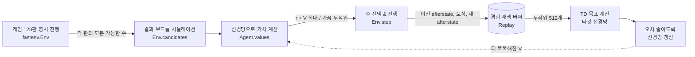
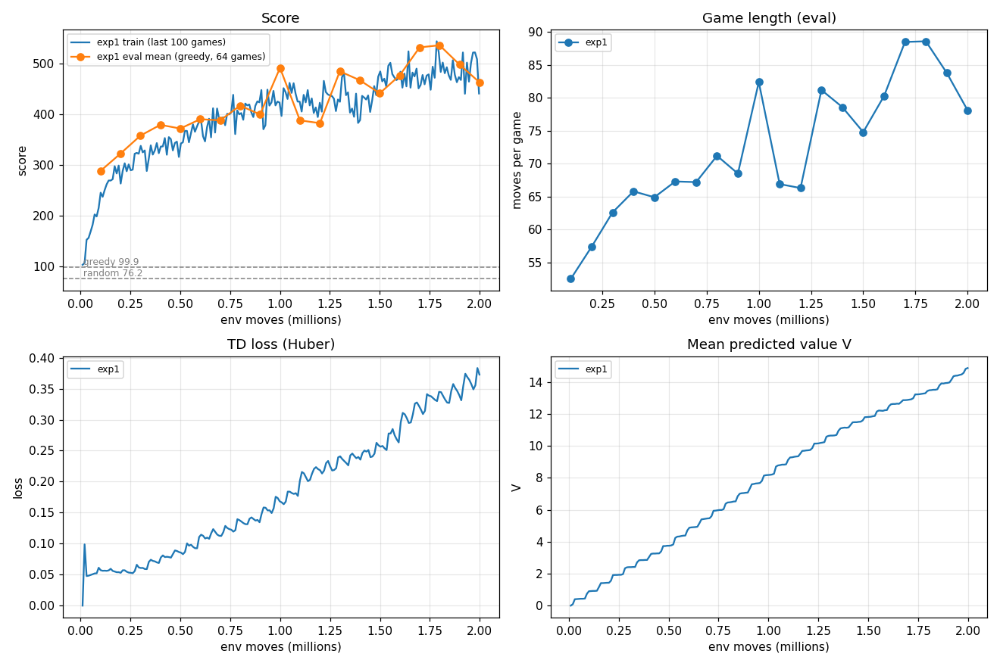

# Blocky 강화학습 실험 기록

목표: Blocky에서 높은 점수를 내는 AI를 강화학습으로 만들고, 최종적으로 **내가 고른 블록 3개에 대해 AI가 추천하는 수(순서 + 위치)를 보드에 표시**하는 도구를 만든다.

이 문서는 세 부분으로 되어 있다.
1. **강화학습 기초**: 처음 보는 사람도 이해할 수 있도록 핵심 개념만 정리
2. **코드로 본 강화학습**: 위 개념이 이 프로젝트의 어떤 파일, 어떤 줄에서 어떻게 구현되는지
3. **실험 기록**: 실제 학습 결과와 그래프, 그리고 AI가 무엇을 배웠는지

---

## Part 1. 강화학습 기초

### 1.1 강화학습이란

정답을 알려주는 대신, **직접 해보고 받은 점수(보상)를 보고 스스로 더 나은 행동을 찾게 하는 학습 방법**이다.

- 지도학습: "이 사진은 고양이야"처럼 정답을 보여주고 따라 하게 한다.
- 강화학습: 정답은 없다. 게임을 수만 판 하면서 "이렇게 했더니 점수가 높았다/게임이 빨리 끝났다"를 경험으로 쌓아 스스로 전략을 만든다.

Blocky에는 "이 상황의 정답 수"가 주어져 있지 않다. 그래서 강화학습이 잘 맞는다.

### 1.2 기본 용어 (Blocky에 대입)

| 용어 | 뜻 | Blocky에서는 |
|---|---|---|
| 에이전트 (agent) | 행동을 결정하는 주체 | 수를 고르는 AI |
| 환경 (environment) | 에이전트가 상호작용하는 세계 | 게임 규칙 (`rl/fastenv.py`) |
| 상태 (state, s) | 지금 상황 | 보드 96칸의 채움 여부 + 대기 블록 3개 |
| 행동 (action, a) | 에이전트의 선택 | "몇 번째 블록을 어느 위치에 놓을지" |
| 보상 (reward, r) | 행동 직후 받는 점수 | 놓은 삼각형 수 + 지운 삼각형 수 |
| 에피소드 (episode) | 시작~끝 한 판 | 게임 한 판 (게임 오버까지) |
| 정책 (policy, π) | 상태 → 행동 규칙 | "이 상황에선 이 수를 둔다" |
| 가치 (value, V) | 그 상태에서 앞으로 받을 보상의 기대 합 | "이 보드면 앞으로 몇 점 더 낼 수 있을까" |

### 1.3 핵심 아이디어: 당장의 점수 vs 앞으로의 점수

에이전트의 목표는 **한 수의 점수가 아니라 게임 전체 점수**를 최대화하는 것이다.

- 지금 3줄을 지워 큰 점수를 얻어도, 보드가 들쭉날쭉해져 다음 블록을 못 놓으면 게임이 끝난다.
- 반대로 지금은 점수가 적어도 보드를 깔끔하게 유지하면 오래 살아남아 결국 더 많은 점수를 얻는다.

그래서 "앞으로 얻을 점수의 기대값", 즉 **가치(value)** 를 추정하는 것이 핵심이다.

### 1.4 할인율 γ (gamma)

미래 보상을 얼마나 중요하게 볼지 정하는 값(0~1)이다.

```
가치 = r1 + γ·r2 + γ²·r3 + γ³·r4 + ...
```

- γ = 0.99면 100수 뒤의 보상은 약 0.37배로 반영된다. 대략 "앞으로 100수 정도"를 내다보는 셈이다.
- γ가 너무 작으면 근시안적이 되고, 1에 너무 가까우면 학습이 불안정해진다.

### 1.5 TD 학습 (Temporal Difference): 가치를 배우는 방법

가치를 직접 알 수는 없다. 그래서 **"지금의 예측"을 "한 수 둔 뒤의 예측"에 맞춰 조금씩 고친다.**

```
V(지금) ← γ × ( 다음 수의 보상 + V(다음) )
                └──────── TD 목표(target) ────────┘
```

비유: 일기예보에서 월요일에 "금요일 비 70%"라고 했는데, 화요일 예보가 "금요일 비 90%"라면 월요일 예측을 90% 쪽으로 고친다. 금요일이 될 때까지 기다리지 않고 **다음 예측을 이용해 지금 예측을 수정**하는 것이 TD 학습이다. 마지막(게임 오버)에는 V = 0이라는 확실한 정답이 있어서, 이 정보가 뒤로 조금씩 전파된다.

### 1.6 Afterstate (수를 둔 직후의 상태)

이 프로젝트가 쓰는 방식이다. 테트리스나 블록 퍼즐처럼 **"수를 두면 결과가 정확히 정해지는" 게임**에 특히 잘 맞는다.

- 일반적인 방법(Q-learning)은 "상태 + 행동"마다 점수 Q(s, a)를 배운다. Blocky는 행동이 최대 수백 개라서 배우기 어렵다.
- Afterstate 방식: 수를 두는 결과는 시뮬레이션으로 정확히 알 수 있다. 그래서 **둔 뒤의 보드 상태 하나의 가치**만 배우면 된다.
  1. 둘 수 있는 모든 수를 실제로 시뮬레이션해 본다. (보통 50~150개)
  2. 각 결과 보드에 대해 `즉시 점수 + V(결과 보드)`를 계산한다.
  3. 가장 큰 수를 둔다.
- 장점: 서로 다른 수가 같은 결과 보드를 만들면 같은 가치를 공유하므로, 적은 경험으로 빨리 배운다.

Blocky에서 afterstate = (줄 삭제까지 끝난 보드, 대기열에 남은 블록들). 남은 블록도 넣는 이유는 "남은 블록이 육각형이면 큰 빈 공간을 남겨둬야 한다" 같은 판단을 하려면 그 정보가 필요하기 때문이다.

### 1.7 탐험과 활용 (exploration vs exploitation)

- 항상 지금 최선이라고 믿는 수만 두면(활용) 더 좋은 수를 영영 발견하지 못할 수 있다.
- 그래서 가끔(확률 ε) 무작위 수를 둔다(탐험). 이것을 **ε-greedy**라고 한다.
- 학습 초반에는 ε를 크게(10%), 후반에는 작게(0.5%) 줄여 간다.

### 1.8 신경망 (가치 함수 근사)

보드 경우의 수는 2^96가지라서 표로 외울 수 없다. 그래서 **보드 → 가치**를 계산하는 함수를 신경망으로 만든다. 비슷한 보드는 비슷한 가치를 갖도록 일반화한다.

- CNN(합성곱 신경망)은 이미지처럼 **주변 칸의 패턴**(구멍, 막힌 칸, 거의 찬 줄)을 잘 잡아낸다.

### 1.9 학습을 안정시키는 두 가지 장치

1. **경험 재생 (Experience Replay)**: 경험(상태, 보상, 다음 상태)을 큰 버퍼에 모아두고, 무작위로 섞어 꺼내 학습한다. 연속된 수끼리는 비슷해서, 그대로 학습하면 한쪽으로 치우치기 때문이다.
2. **타깃 네트워크 (Target Network)**: TD 목표를 계산할 때 쓰는 신경망을 따로 복사해 두고 가끔만 갱신한다. 내가 맞추려는 목표가 매 순간 같이 움직이면(자기 꼬리 잡기) 학습이 발산하기 때문이다.

---

## Part 2. 코드로 본 강화학습

### 2.1 파일 구성

```
blocky_core.py        원본 게임 규칙 (pygame UI가 사용)
blocky.py             사람이 플레이하는 pygame 화면
rl/fastenv.py         [환경] 학습용 고속 게임 엔진 (비트 연산)
rl/test_fastenv.py    원본 규칙과 동일한지 검증 + 기준선 점수
rl/model.py           [가치 함수] 신경망 V(afterstate)
rl/agent.py           [정책] 모든 수 시뮬레이션 → 가치 최대인 수 선택, 3블록 계획
rl/train.py           [학습 루프] 수집 → 경험 재생 → TD 업데이트 → 평가
rl/evaluate.py        한 수씩 vs 3개 계획 성능 비교
rl/insights.py        가설 실험 → 사람용 팁 (3.7)
rl/release.py         표준 벤치마크 → 더 좋으면 새 버전 등록 (3.8)
rl/export_web.py      ONNX 변환 + 웹용 게임 데이터 (3.9)
rl/plot.py            학습 곡선 그래프
ai_app.py             PC용 추천/관전 앱 (모델 버전 선택)
models/vX.Y.Z/        버전별 모델 (.pt, .onnx, model_info.json)
docs/index.html       웹 데모 (GitHub Pages)
runs/<실험이름>/       학습 로그(csv), 체크포인트 (git 제외)
docs/RL_LOG.md        이 문서
```

### 2.2 학습 한 바퀴의 흐름



### 2.3 개념 ↔ 코드 대응

**① 환경: `rl/fastenv.py`**

- 보드는 96비트 정수 하나다. `board & pl.mask == 0`이면 놓을 수 있다.
- 26개 블록의 가능한 모든 위치를 미리 계산해 둔다(`PLACEMENTS`). 그래서 수 하나를 시뮬레이션하는 데 비트 연산 몇 번이면 된다(초당 약 3만 수).
- `apply(board, pl)`: 블록을 놓고 꽉 찬 줄을 지운 뒤 `(새 보드, 보상)`을 돌려준다. 보상 함수가 여기 있다.
- `Env.candidates()`: 지금 둘 수 있는 모든 수와 각 수의 결과(afterstate)를 돌려준다.

**② 가치 함수: `rl/model.py`의 `ValueNet`**

- 입력: 보드를 8×15 격자 이미지로 펼친 것(채움, 보드 안쪽 여부, △/▽ 방향 3채널) + 남은 블록 개수 벡터(26)
- CNN(ResBlock 4개) → 블록 정보와 합침 → 숫자 하나(가치)
- `encode()`: 비트 보드를 신경망 입력 텐서로 바꾼다.

**③ 정책: `rl/agent.py`의 `Agent.choose_many()`**

```python
q = 즉시보상 * REWARD_SCALE + V(afterstate)    # 모든 후보 수에 대해
j = q.argmax()                                 # 가장 좋은 수
if rng.random() < eps: j = 무작위               # ε-greedy 탐험
```
128판의 모든 후보(수천~수만 개)를 한 번에 GPU로 보내서 빠르게 계산한다.

**④ 학습 루프: `rl/train.py`의 `main()`**

```python
while steps < 총스텝:
    moves = agent.choose_many(envs, eps)          # ③ 128판에서 각각 한 수 선택
    for 각 판:
        if 게임오버: 버퍼에 (이전 afterstate, 0, 끝) 저장 → 새 게임
        else:       버퍼에 (이전 afterstate, 이번 보상, 이번 afterstate) 저장
                    env.step(...)                  # ① 실제로 진행
    for 2번:                                       # 경험 재생 학습
        batch = replay.sample(512)
        target = γ * (r + (1-done) * V_타깃(다음 afterstate))   # 1.5의 TD 목표
        loss = Huber(V(지금 afterstate), target)
        역전파 → 신경망 갱신
        1000번마다 타깃 신경망 ← 현재 신경망 복사       # 1.9 타깃 네트워크
    10만 스텝마다: 탐험 없이 64판 평가 → 로그, 최고 모델 저장
```

### 2.4 하이퍼파라미터 (exp1 기준)

| 이름 | 값 | 의미 |
|---|---|---|
| `envs` | 128 | 동시에 진행하는 게임 수 |
| `gamma` | 0.99 | 할인율 (약 100수 앞을 봄) |
| `REWARD_SCALE` | 0.1 | 보상을 0.1배로 줄여 신경망 출력 범위를 안정화 |
| `lr` | 3e-4 | 학습률 (Adam) |
| `batch` / `updates` | 512 / 2 | 한 스텝마다 512개짜리 미니배치로 2번 갱신 |
| `replay` | 500,000 | 경험 버퍼 크기 |
| `eps` | 0.10 → 0.005 | 탐험 확률 (전체의 30% 구간 동안 감소) |
| `target-every` | 1000 | 타깃 신경망 갱신 주기 |
| `max-moves` | 3000 | 한 판 최대 수 (너무 길어지는 것 방지) |

---

## Part 3. 실험 기록

### 3.1 환경

| 항목 | 내용 |
|---|---|
| GPU | NVIDIA RTX 2070 SUPER 8GB (driver 566.36, CUDA 12.7) |
| CPU | 6 logical threads |
| Python | 3.13.9 (anaconda) |
| 라이브러리 | PyTorch 2.14.1+cu126, numpy, matplotlib 3.10.6, pygame 2.6.1 |

### 3.2 게임 규칙 요약 (학습 환경 기준)

- 보드: 삼각형 96칸 육각형 (행별 9·11·13·15·15·13·11·9), 좌표 `(x, y)`, `x+y` 짝수 ▽ / 홀수 △
- 블록: 고정 방향 기준 26종 (1칸 2, 2칸 3, 3칸 6, 4칸 14, 육각형 1)
- 대기 블록 3개를 모두 쓰면 새 3개가 무작위(균등)로 나옴
- 점수 = 놓은 삼각형 수 + 지워진 삼각형 수 (가로/두 대각선, 24줄, 겹친 칸은 1번)
- 남은 블록을 어디에도 놓을 수 없으면 게임 오버

### 3.3 고속 시뮬레이터 검증

- 원본 규칙(`blocky_core.py`)과 **무작위 200판, 매 수마다 보드·점수·합법 수 집합이 완전히 일치**함을 검증 (`python -m rl.test_fastenv`)
- 속도: 단일 스레드 약 27,000~30,000 수/초

### 3.4 기준선 (baseline): 300판, 고정 시드

| 정책 | 평균 | 중앙값 | 최고 |
|---|---:|---:|---:|
| 무작위 | 76.2 | 69 | 200 |
| 탐욕 (당장 점수 최대인 수) | 99.9 | 90 | 231 |

→ 당장 점수만 보는 탐욕 정책도 무작위보다 고작 31% 높다. **줄을 완성하는 것보다 "다음 블록을 놓을 공간을 남기는 것"이 중요하다**는 것을 시사한다. 강화학습이 배워야 할 핵심이 바로 이 장기적 판단이다.

### 3.5 스모크 테스트 (4만 수, 약 40초)

코드가 제대로 도는지 확인하려고 짧게 돌려 봤다.
- 2만 수 후 평가 평균 167점, 4만 수 후 평가 평균 **241점** (탐욕 기준선 100점의 약 2.4배)
- 학습 40초 만에 이미 기준선을 크게 넘었다. 방법 자체가 이 게임에 잘 맞는다는 신호다.

### 3.6 exp1: 기본 설정, 200만 수

설정은 2.4절 표와 같다. 학습 시간은 약 41분(초당 약 850~1,000수)이다.



**학습 중 평가 (탐험 없이 한 수씩, 고정 시드 64판)**

| 학습한 수 | 10만 | 30만 | 60만 | 100만 | 120만 | 150만 | 180만 | 200만 |
|---|---:|---:|---:|---:|---:|---:|---:|---:|
| 평균 점수 | 289 | 358 | 391 | 492 | 383 | 442 | **536** | 463 |
| 판당 수 | 53 | 63 | 67 | 82 | 66 | 75 | 89 | 78 |

**그래프 읽는 법과 알게 된 것**

1. **점수 (왼쪽 위):** 처음 10만 수 만에 기준선(탐욕 100점)의 약 3배가 됐고, 이후 천천히 오른다. 평가 점수가 ±100점씩 출렁이는 이유는 두 가지다. 64판으로는 운의 영향이 크고, 학습 중인 정책 자체도 조금씩 흔들린다. 그래서 **"학습 중 최고점"만 믿지 말고, 더 많은 판으로 다시 평가해서 모델을 골라야 한다** (→ 3.8 표준 벤치마크).
2. **판 길이 (오른쪽 위):** 점수와 거의 똑같은 모양이다. 이 게임에서 점수를 올리는 핵심은 **오래 살아남는 것**이다. 한 수당 점수는 큰 차이가 없고, 판이 길어질수록 점수가 커진다.
3. **예측 가치 V (오른쪽 아래):** 계속 직선으로 올라가고 있다. 아직 **수렴하지 않았다**는 뜻이다. 계단 모양이 보이는 이유는 TD 목표를 만드는 타깃 신경망이 1000번 갱신마다 한 번씩만 바뀌기 때문이다. 타깃이 바뀔 때마다 "한 수 더 먼 미래"의 가치가 반영된다. 즉 가치 정보가 뒤로 전파되는 속도가 학습 속도의 병목이다.
4. **TD 손실 (왼쪽 아래):** 손실이 올라가는 건 나빠지고 있다는 뜻이 아니다. V 자체가 커지면서 오차의 크기도 함께 커지는 것이다. 강화학습에서는 지도학습처럼 "손실이 내려가야 좋다"가 성립하지 않는다는 좋은 예다.

**다음 실험 방향 (3.4의 V 미수렴에서 도출)**
- 더 길게 학습하기 (PATCH 후보)
- 가치 전파를 빠르게 하기: n-step 리턴(여러 수의 보상을 한 번에 반영), 타깃 갱신 주기 줄이기 (MINOR 후보)
- γ를 0.995로 올려 더 먼 미래의 게임 오버까지 고려하기 (MINOR 후보)

### 3.7 AI가 배운 것: 사람에게 가르칠 수 있는 팁

**방법:** "AI는 이렇게 하는 것 같다"는 느낌이 아니라 가설을 하나씩 실험으로 확인했다 (`python -m rl.insights`).
- 사용한 모델: v1.0.0
- 판 수: 고정 시드 200판(계획 비교는 64판)
- 비교 대상: 탐욕 정책(당장 점수가 가장 높은 수)
- 규칙 강제 실험: AI 모델은 그대로 두고 규칙 하나만 강제했을 때 점수가 어떻게 변하는지 봤다.

| 측정 항목 | AI (v1.0.0) | 탐욕 정책 |
|---|---:|---:|
| 평균 점수 / 판당 수 | 451 / 76수 | 102 / 25수 |
| 줄을 지울 수 있는 상황이었던 수의 비율 | **33.6%** | 7.1% |
| 지울 수 있을 때 실제로 지운 비율 | 65% | 100% |
| 두 줄 이상 동시 삭제가 가능했던 수의 비율 | 1.2% | 0.1% |
| 가장자리 칸 점유율 / 중앙 칸 점유율 | 39% / 41% | 26% / 43% |
| 육각형(6칸)을 놓을 자리가 있었던 비율 | **91.5%** | 74.3% |
| 26종 블록 중 놓을 수 있는 종류 수 (평균) | 25.5 | 24.5 |
| 보드에 채워진 칸 수 (평균) | 38.9 | 37.6 |

| 규칙 강제 실험 (같은 200판) | 평균 점수 |
|---|---:|
| AI 그대로 | **450.8** |
| 지울 수 있으면 무조건 지우기 | 442.5 (−1.8%) |
| 항상 가장 많은 줄을 지우는 수 두기 | 442.5 (−1.8%) |

| 한 수씩 vs 3개 한꺼번에 계획 (같은 64판) | 평균 | 중앙값 | 판당 수 |
|---|---:|---:|---:|
| 한 수씩 | 453.9 | 425.5 | 77 |
| **3개 한꺼번에 계획** | **893.1** | 709.5 | 142 |

#### 팁 1. 블록은 1개씩이 아니라 3개를 한꺼번에 계획하라 (효과 가장 큼, 약 2배)
같은 AI라도 3개의 순서와 위치를 함께 따져 보게 하면 평균 점수가 454점에서 893점으로 **두 배**가 된다. 하나만 보고 좋은 자리에 두면, 남은 두 블록이 들어갈 자리를 막는 경우가 많다. 둘 때마다 "남은 블록이 어디에 들어갈지"를 먼저 확인하자.

#### 팁 2. 줄을 "지우는 것"보다 "지울 수 있는 상황을 만드는 것"이 실력이다
AI의 보드에서는 매 수 중 34%가 줄을 지울 수 있는 상황이다. 탐욕 정책은 7%에 그친다. AI는 한두 칸만 비어 있는 줄을 여러 개 만들어 두고, 어떤 블록이 와도 어딘가에서 줄을 지울 수 있게 해 둔다.

#### 팁 3. 지울 수 있다고 무조건 지울 필요는 없다. 다만 크게 손해 보지도 않는다
AI는 지울 수 있는 상황에서도 35%는 지우지 않고 다른 수를 둔다. "가능하면 무조건 지우기"를 강제하면 점수가 1.8% 떨어진다. 대부분은 지우는 게 맞지만, 지우는 수가 보드 모양을 망가뜨리면 그 줄은 다음 턴으로 미뤄도 된다. 줄은 남겨 두면 나중에도 지울 수 있다.

#### 팁 4. 2~3줄 동시 삭제(콤보)를 노리지 마라
이 게임은 "지워진 삼각형 수"만큼만 점수를 준다. 겹치는 칸은 한 번만 세므로 **콤보 보너스가 없다**. 두 줄 이상을 동시에 지울 기회 자체가 AI에게도 1.2%의 수에서만 생기고, "항상 가장 많은 줄 지우기"를 강제해도 점수가 오르지 않는다(−1.8%). 콤보를 위해 오래 기다리는 것보다 한 줄씩 꾸준히 지우는 게 낫다.

#### 팁 5. 가장자리와 모서리를 비워 두지 마라
탐욕 정책은 가장자리를 26%만 채우고 중앙(43%)에 몰아서 둔다. 그러면 가장자리에 블록을 놓기 어려운 빈칸이 남는다. AI는 가장자리(39%)와 중앙(41%)을 **거의 같은 비율**로 채운다. 가장자리도 일찍 채워서 중앙의 큰 공간을 남겨 두자.

#### 팁 6. 육각형(6칸)이 들어갈 자리는 항상 남겨 둬라
게임 오버를 일으킨 블록을 보면 육각형이 12%를 차지한다. 육각형이 나올 확률은 26분의 1(3.8%)이므로 **약 3배나 자주 게임을 끝낸다**. 4칸 블록도 게임 오버의 77%를 차지한다. AI의 보드에는 91.5%의 순간에 육각형 자리가 있다(탐욕 정책은 74%).

#### 팁 7. 빈칸의 "개수"보다 "모양"이 중요하다
의외로 AI의 보드가 탐욕 정책보다 평균적으로 **조금 더 차 있다**(38.9칸 vs 37.6칸). 그런데도 3배 오래 살아남는다. 빈칸을 많이 남기는 게 아니라, 빈칸을 큰 덩어리로 모아서 어떤 블록이든 들어갈 수 있게 하는 게 핵심이다. 그 결과 AI의 보드에서는 26종 중 평균 25.5종이 놓일 수 있다.

#### 팁 8. 한 턴 안에서 "만들고, 마지막에 지운다"
줄 삭제가 포함된 3개 계획 211개 중 149개(71%)는 첫 번째 블록이 아니라 2·3번째 블록으로 줄을 지운다. 앞 블록으로 줄을 완성 직전까지 만들고, 뒤 블록으로 지우는 흐름이다. 순서상 "큰 블록 먼저"는 51%로, 약한 경향일 뿐 규칙은 아니다.

> 주의: 위 팁은 v1.0.0(100만 수 학습) 모델이 배운 행동에서 나온 것이다. 모델이 더 좋아지면 다시 측정해서 갱신한다.

### 3.8 모델 버전 관리와 표준 벤치마크

학습 중 평가(64판, 한 수씩)는 출렁임이 크다. 그래서 버전을 등록할 때는 **고정된 표준 벤치마크**로 다시 평가한다 (`python -m rl.release`).
- **plan3:** 3개를 한꺼번에 계획(beam 64, 앱·웹과 같은 방식), 고정 시드 64판. **이 평균이 이전 최고보다 높을 때만 새 버전을 등록한다.**
- **greedy:** 한 수씩 둠, 고정 시드 200판.

버전 규칙:
- **PATCH** `1.0.x`: 같은 설정으로 더 학습
- **MINOR** `1.x.0`: 하이퍼파라미터·신경망 크기·학습 기법 변경
- **MAJOR** `x.0.0`: 알고리즘이나 입력 형식, 게임 규칙 변경

자세한 내용은 [models/README.md](../models/README.md)에 있다.

| 버전 | 내용 | plan3 평균 | plan3 최고 | greedy 평균 | greedy 최고 |
|---|---|---:|---:|---:|---:|
| v1.0.0 | exp1, 100만 수 시점 | 893.1 | 2844 | 451.6 | 1735 |
| **v1.0.1** | exp1, 180만 수 시점 (같은 설정으로 더 학습 → PATCH) | **1004.6** | **3878** | 538.0 | 1704 |

### 3.9 웹 데모 (GitHub Pages)

- 주소: https://kym343.github.io/Blocky/ (소스는 `docs/index.html`, `docs/web/app.js`)
- GitHub Pages는 정적 호스팅이라 파이썬/PyTorch를 실행할 수 없다. 그래서 신경망을 **ONNX**로 변환해서 브라우저에서 **onnxruntime-web**(WebAssembly, 가능하면 WebGPU)으로 실행한다.
- 게임 규칙 데이터(칸, 블록, 줄, 가능한 배치)도 파이썬에서 JSON으로 내보낸다. 그래서 웹과 학습 환경의 규칙이 어긋날 수 없다.
- 검증(`index.html?selftest`, 헤드리스 Chrome으로 실행):
  - 무작위 20판 430수: 보드·점수 완전히 일치
  - 신경망 출력: PyTorch와의 차이 최대 0.000004
  - 3개 계획: 6개 사례 모두 점수와 최종 보드가 파이썬과 같음 (동점인 수 중 고르는 순서만 다를 수 있음)
- 브라우저 CPU 기준 계획 시간: 탐색 폭 "보통"(12)이 약 1~3초, "정확"(32)이 약 1~4초.
